# Integration and implementation audit — 30 October 2026

**4 November 2026 update.** See [Windows live acceptance](LIVE-ACCEPTANCE.md) and [Windows demo steps](WINDOWS-LIVE-DEMO.md) for current native Suricata, firewall and Ollama results. Earlier installation observations below are historical.

This is a source review and bounded functional validation, not an independent penetration test, legal certification or a guarantee of zero errors. The original proposal is mapped to M01–M12 in README.md. This revision extends M04, M07, M08, M10 and M12 without introducing a hardware deployment profile.

## Implemented data flow

```mermaid
flowchart LR
  A[Real Suricata process on Linux / WSL] -->|EVE JSON + status| B[Enrolled Windows or Linux collector]
  W[Windows events / FIM / YARA / journal / Zeek] --> B
  B --> C[Durable local spool]
  C -->|Authenticated ingestion| D[Receipt: STAGED]
  D --> E[Sealed raw bytes + canonical envelope]
  E --> F[Hash chains + signed checkpoints]
  F --> G[Independent witness when configured]
  E --> H[Assigned case]
  H --> I[Local statistical AI / optional local Ollama]
  I --> J[Cited derived output + analyst review]
  H --> K[Signed ZIP: originals, PDF, DOCX, proof]
  J --> K
  F --> L[MEGA archive job]
  K --> L
  L --> M[Official MEGAcmd upload]
  M --> N[Download + SHA-256 match]
  N --> O[Verified object + signed inventory]
  O --> P[Staged restore check; originals unchanged]
```

## Findings addressed

| Finding | Change | Verification |
|---|---|---|
| Tool adapters could be mistaken for installed/running tools | Tools & sensors distinguishes actual server probes, configured models and remote collector status | Browser checks and package/vendor probes |
| Windows vendor client can start a persistent process inheriting stdout, causing a pipe wait to outlive the client | Bounded process wrapper waits for the specific child and reads a bounded temporary output file | Regression checks for inherited output and timeout; real MEGAcmd calls |
| Cloud success could be claimed on upload acknowledgement alone | Full readback hash is required before VERIFIED; explicit restore-check detects remote changes | Corrupt-readback tests; genuine MEGA transfer/archive/restore |
| Local-only preservation lacked an integrated MEGA workflow | Closed segments/manifests, artifacts, reports, checkpoints and metadata/custody snapshot; content-addressed remote object folders; signed inventory | Unit coverage for every category; live archive covered segment, manifest, checkpoint, report and metadata |
| AI output could be confused with source evidence | Separate ai_runs, original input IDs/hashes, output digest committed to custody, UNREVIEWED status, explicit analyst decisions | Genuine scikit-learn output/citations and frozen report test |
| Queued analysis could outlive case permissions | Scope check at execution; active role/case access rechecked before saving | Revoked-scope and route authorization tests |
| LLM hallucinations could cite nonexistent evidence | Structured schema, bounded output, citation allowlist, local-only endpoint/model check; invalid output rejected | Fabricated citation test; no real local LLM inference claimed |
| Slow cloud/model work could block receipt sealing and periodic anchoring | Sealing/rules, long jobs and periodic checkpoint scheduling have separate threads | Browser jobs complete and existing durable ingestion tests; workload benchmarking still required |
| Reports lacked native PDF and editable Word output | Frozen case reports now include DOCX/PDF plus original proof/raw files, notes, scoped custody and AI snapshot | DOCX parsing, PDF header/page rendering, signed-package verification |
| Untrusted XML control characters can break human-readable report rendering | Replace unsupported controls only in displayed report text; original bytes/JSON retained | Code inspection; existing renderer tests |
| New GUI screens and case cards needed consistent layout | Three integrated pages, corrected case-card styles, grouped navigation and mobile layout | Sixteen-screen browser walkthrough; no horizontal mobile overflow |

## Acceptance evidence

- Windows suite: 38 Python tests passed after the final fixes, plus three frontend tests; see VALIDATION.md and the recorded local test logs. Unit fixtures are labelled synthetic; mocks are not claimed as vendor validation.
- Genuine MEGAcmd 2.7.0 installed from the official vendor installer with valid MEGA Privacy LLC signature. Account details and credentials were not copied into application configuration.
- `mega-live-check.json`: a 138-byte harmless test file was uploaded/downloaded and its SHA-256 matched. The first test-harness readback used mixed Windows path separators and failed; using the native separator succeeded. The production archival adapter already uses the native separator.
- `mega-live-archive-check.json`: the application adapter uploaded and read back seven objects from an isolated synthetic case, verified its signed inventory bytes, and successfully staged/restored the report ZIP. No original user evidence was uploaded during these checks. Test folders remain under `/CyberBlackBox/connection-tests` and `/CyberBlackBox/acceptance-tests` for inspection.
- Browser acceptance: all 16 pages opened, local analysis completed, analyst review was saved, and a report export completed. No page JavaScript errors or HTTP 5xx responses; 390 px mobile viewport had no horizontal overflow. Screenshots use synthetic data.
- The generated browser-test report package passed offline verification against its deployment key: six evidence records, no failures. Its four-page PDF was rendered and checked for readable text. This is LOCAL_CHECK_ONLY; an independent witness was not asserted for this run.

## Remaining acceptance and limits

1. Ubuntu/Suricata installation depends on Windows WSL state and may require a reboot. Follow the final installation status and INTEGRATIONS-GUIDE.md. Until a genuine capture is observed, script/configuration readiness is not live IDS acceptance. The supplied rule is a harmless pipeline marker; it is not comprehensive threat coverage.
2. WSL visibility is limited to the selected Linux interface. Full Windows/LAN visibility, packet-loss budgets, rule-feed updates and independent labelled detection evaluation require a suitable authorized sensor setup.
3. MEGA transfer verification does not establish permanent immutability, independent witnessing or full database/key restoration. Previously verified files can later be deleted remotely; Restore check tests their current availability. Real acquisition artifacts remain covered by automated tests, but were not captured from the user's endpoint for the live cloud experiment.
4. Optional Ollama, Zeek and Volatility are adapters, not installed/validated runtimes in this build. Statistical AI is working locally; no language-model quality claim is made. Prompt injection and incorrect source observations remain risks even with cited IDs and no tool execution.
5. Docker/Linux/PostgreSQL, production mTLS, Object Lock, external witnessing, privileged acquisition and disaster recovery still need destination-specific acceptance. Local passing tests do not certify cloud deployment.
6. Metadata snapshots and report construction are prototype-scale operations; large evidence sets consume memory/disk. Long transfers serialize other long jobs. SQLite transactions can still contend. Throughput, p95 latency, capture gaps, dropped packets and resource ceilings need measurement under the intended workload.
7. Crash recovery may repeat a remote side effect or create another derived output. Hashes and IDs make this inspectable; external exactly-once behavior is not guaranteed. A timed-out vendor transfer may still be active in the vendor service.
8. A compromised collector can lie about source events/status; a privileged server/signing-key compromise can forge future data. Preserve independent trusted keys/checkpoints and maintain OS/disk protections. Hashes cannot establish source truth or legal admissibility.

No universal “all features perfect” or “zero errors” claim is supported. Promote a component to operational status only after its recorded environment test passes.

Final WSL check: no installed Ubuntu distribution. The approved installation was retried and Windows again reported that changes require a reboot. No Suricata live capture was claimed or fabricated.
